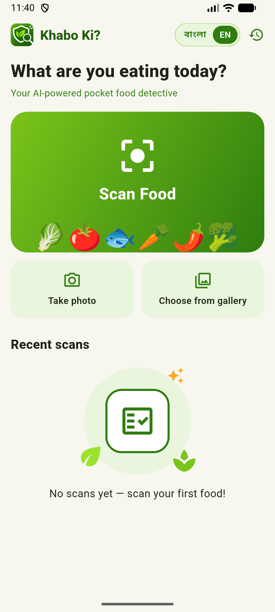
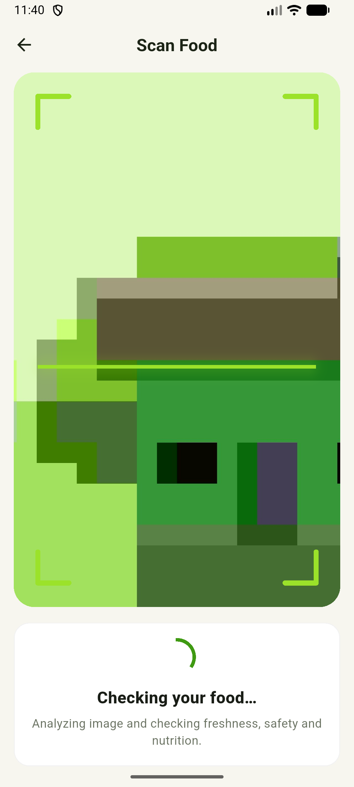
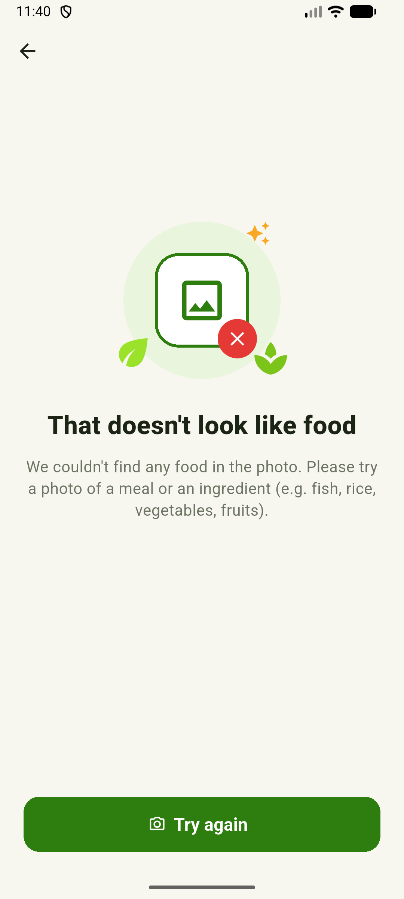

<h1 align="center">Khabo Ki? (খাবো কি?)</h1>

<b>Your AI-powered pocket food detective</b> Eat like a Boss, not like a Victim.

Khabo Ki? ("What shall I eat?") is an Android app for Bangladesh. Point the camera at food and it tells you:

- **What it is**: detected foods
- **Freshness**: fresh, check before eating, or likely spoiled (from visual signs only)
- **Safety score** (0–100) and spoilage risks
- **Nutrition**, portion estimate and a **budget tip in BDT**
- Everything in **English and Bangla**

> ⚠️ The app judges food from a photo only. It **cannot** detect bacteria, chemicals or formalin, and it says so in the app.

| Home | Scanning | Not food |
|---|---|---|
|  |  |  |

## Download

Get the latest APK from **[Releases](https://github.com/nuhanhabib/khabo-ki/releases/latest)**. On your phone, open the link, tap `KhaboKi-vX.Y.Z.apk`, and allow "Install unknown apps" when asked.

## For developers

| Read this | To learn |
|---|---|
| [docs/SETUP.md](docs/SETUP.md) | Set up your PC and run the app (start here) |
| [docs/ARCHITECTURE.md](docs/ARCHITECTURE.md) | How the app, the Worker and Gemini fit together, and what each file does |
| [CONTRIBUTING.md](CONTRIBUTING.md) | Branches, pull requests, code style and releasing |
| [SECURITY.md](SECURITY.md) | Security rules everyone must follow |
| [docs/ROADMAP.md](docs/ROADMAP.md) | What's done and what's next |

**Tech:** Flutter 3.47.9 (Dart) · Cloudflare Workers (TypeScript) · Google Gemini · GitHub Actions. Everything runs on free tiers.

## Team

- **Nuhan Habib** ([@nuhanhabib](https://github.com/nuhanhabib)), owner
- [@MayazthecrazyMontasim](https://github.com/MayazthecrazyMontasim), developer

Started at Next Gen Ideathon 2025, BRAC University (BUSB).

[Privacy policy](PRIVACY.md)
